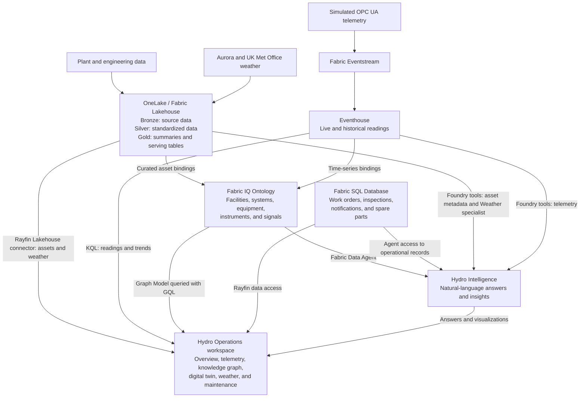

# Hydro Intelligence: Connected Hydropower Operations

## Abstract

Hydro Operations brings plant information, live equipment readings, maintenance records, and
weather into one operational workspace. For operators, engineers, and maintenance planners, it
connects three everyday questions: **What is happening? Which assets are affected? What should we
investigate next?** Users can move from a station to a turbine, inspect its signals and maintenance
context, and use **Hydro Intelligence**, the AI assistant, to explore available operational data in
natural language.

Microsoft Fabric provides the foundation. A medallion Lakehouse organizes source data into
progressively more useful layers, while an Eventhouse handles real-time telemetry. A Fabric IQ
ontology connects measurements to the instruments, equipment, systems, and facilities they describe.
The delegated Rayfin Lakehouse connector serves asset and weather data to the application, and a separate SQL database holds
operational records. Weather forecasts add an external planning perspective alongside current plant
conditions. Together, these capabilities support informed investigation and planning, with people
remaining responsible for operational decisions.

## Simplified Architecture

The diagram combines two assistant options: **Fabric Data Agent**, grounded in the ontology and
configured SQL source, and **Azure AI Foundry**, using explicit tools to retrieve assets, telemetry,
and operational records. They do not have identical data access.

**Connector access and GQL serve different purposes.** The Lakehouse connector retrieves tabular
asset and weather data; GQL traverses the ontology's materialized Graph Model for the Knowledge Graph view.
The selected ontology must first be materialized through Manage graph and explicitly bound using
verified ontology-to-graph lineage or an operator-verified binding. No graph ownership is inferred from names.
Live telemetry
is queried separately, so fresh readings do not have to wait for lakehouse processing or graph
refresh. SQL maintenance records are added as application context, not automatically made ontology
entities.

## End-to-End Flow

1. **Collect the context.** Plant and engineering records establish the asset structure. Weather
   ingestion brings in forecasts and available observations. A separate simulator sends OPC UA
   measurements through Eventstream into Eventhouse.
2. **Prepare useful data.** The Lakehouse follows the medallion pattern: Bronze retains source
   material, Silver standardizes identifiers, units, and structures, and Gold provides summaries
   such as equipment health, limit checks, and the latest weather serving tables.
3. **Connect readings to real-world meaning.** The ontology relates a signal to its instrument,
   equipment, system, and facility. Time-series bindings connect that signal to Eventhouse readings.
   A temperature value can therefore be investigated in the context of the turbine it belongs to.
4. **Bring the evidence together.** The SPA reads asset and weather tables through the Lakehouse connector,
   telemetry through KQL, graph relationships through GQL, and maintenance records through Rayfin.
   Shared asset and signal identifiers connect these sources in the user experience.
5. **Investigate with Hydro Intelligence.** A user asks, for example, "Show the latest readings for
   this turbine and its open work orders." The selected assistant retrieves its supported data
   and summarizes the results. The Foundry option can also produce charts and expose its tool-call
   trace for inspection.
6. **Add weather to the planning decision.** The user compares available Aurora and UK Met Office
   forecasts for the relevant location or area, including rainfall, temperature, and wind. Weather
   is also available through the read-only Foundry Weather specialist and its `query_weather` tool.
   The deterministic Supervisor coordinates it with the other specialists for mixed questions.
7. **Decide and follow up.** The operator reviews telemetry, connected assets, and maintenance
   evidence before deciding the next action. Separately configured Operations Agent workflows can
   support notifications; the conversational assistant is not an autonomous plant controller.

For example, a shift engineer investigating unusual turbine vibration can inspect its trend,
locate the associated instrument in the Knowledge Graph, ask for related open work, and review
weather before planning an inspection. The value is connected evidence, not a claim that the AI
has proved the fault's cause.

## Key Characteristics

| Capability | What it means for the user |
| --- | --- |
| Medallion architecture in OneLake | Source records, standardized data, and ready-to-use summaries have distinct roles, making information easier to reuse and trace. |
| Ontology-based context | Facilities, systems, equipment, instruments, and signals share a connected business model instead of appearing as unrelated tables. |
| Real-time intelligence | Recent readings and historical trends are available from Eventhouse alongside asset context and dashboards. |
| Connected operational records | Work orders, inspections, notifications, and spare parts provide maintenance context around the selected asset. |
| Delegated Lakehouse connector | Asset and weather tables are available through a read-only Rayfin connection; users do not need to create a Lakehouse GraphQL API. Existing hosted asset tools still retain a legacy GraphQL dependency. |
| Weather integration | Vendor-specific forecasts and available observations support comparison; rainfall summaries include interval coverage and area-volume estimates. |
| AI-assisted investigation | Natural-language questions can retrieve supported operational evidence, with charts and query traces in the Foundry experience. |
| Access-aware experience | Data access uses the signed-in user's Fabric permissions and Rayfin session; the assistant's tools are limited to configured sources and operations. |

## Current Scope

- **Demonstration, not a production control system.** Plant data, maintenance fixtures, and OPC UA
  telemetry are synthetic. Weather ingestion connects to external providers when configured.
- **Different sources have different freshness.** Lakehouse summaries and graph materialization
  are not the live telemetry feed. Users should consider timestamps, signal quality, and forecast
  coverage when interpreting results.
- **Weather context is not a hydrological forecast.** Current area calculations use representative
  locations and area size to estimate rainfall volume. They do not model runoff, reservoir inflow,
  or future power generation, and weather is not part of the five-entity asset ontology.
- **AI supports judgment.** The current Foundry specialists read data and present results; Fixer may
  stage an editable work-order proposal, but only human approval permits the application to write SQL.
  Weather cannot propose work or operate equipment. Available answers depend on the selected engine,
  enabled sources, permissions, and data availability.

## Validation Note

This overview was checked against the repository implementation by static inspection, not a live
deployment or end-to-end test. Key implementation references:

- [Medallion asset transformations](../Notebooks/RTI_003_ingest_transform_medallion_SelfContained.Notebook/notebook-content.py#L139) and [Gold limit checks](../Notebooks/RTI_003_ingest_transform_medallion_SelfContained.Notebook/notebook-content.py#L592).
- [Ontology time-series property validation and binding setup](../Notebooks/RTI_006_TimeSeriesBinding_RTI_signal.Notebook/notebook-content.py#L1372).
- [Graph Model query path](../HydroOperationsApp/src/services/fabric.ts#L530), [asset queries](../HydroOperationsApp/src/services/fabric.ts#L645), and [weather GraphQL queries](../HydroOperationsApp/src/services/fabric.ts#L686).
- [Foundry assistant tool definitions](../HydroOperationsApp/src/services/copilot/tools.ts#L56), including read-only queries, charts, and 3D model presentation.
- [Fabric Data Agent ontology source](../Notebooks/RTI_009_build_data_agent.Notebook/notebook-content.py#L141) and [SQL source configuration](../Notebooks/RTI_011_seed_sql_wire_graphql_agent.Notebook/notebook-content.py#L184).
- [Weather area calculations and serving projections](../Notebooks/Weather_020_area_calculations.Notebook/notebook-content.py#L145).

For more detail, see [knowledge-graph.md](knowledge-graph.md) and [foundry-copilot.md](foundry-copilot.md).