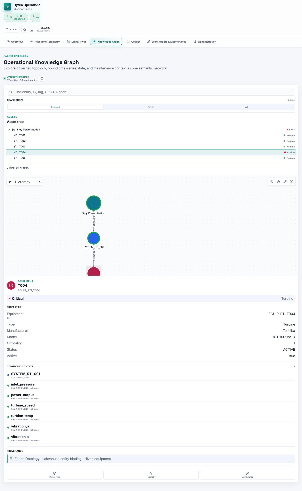
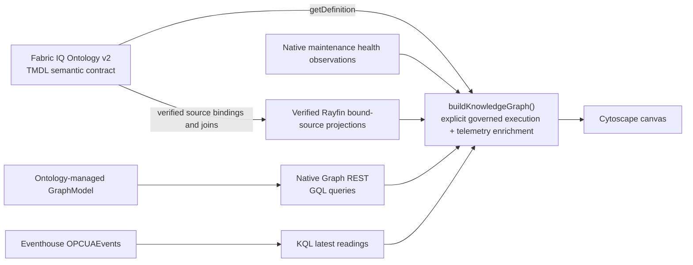
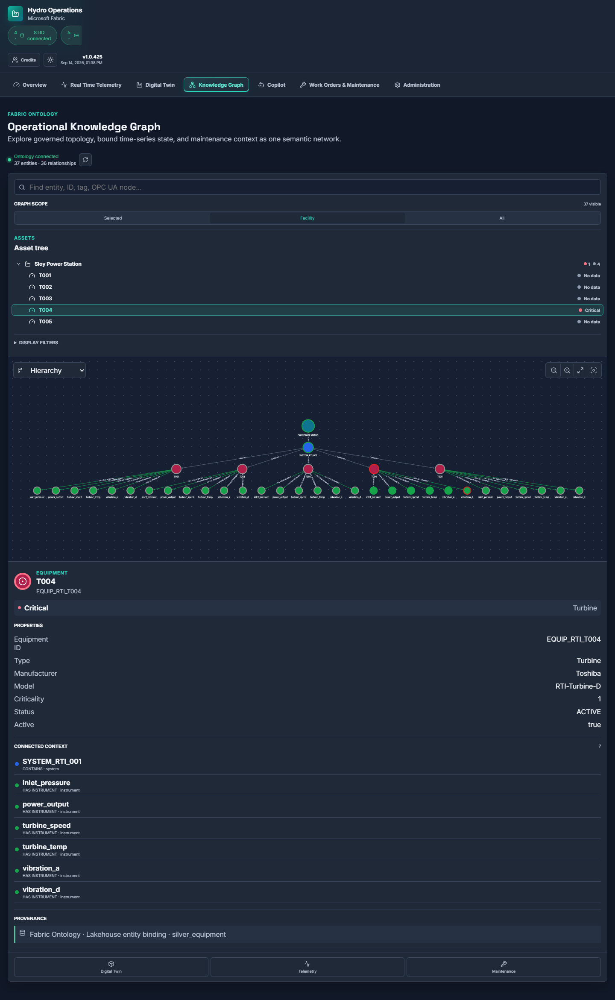

# Hydro Operations Knowledge Graph

## Direct Ontology model and separate native instance view

The default **Ontology model** reads the live numeric generation-2 definition.
Its nodes are entity types, not asset instances; edges are exactly the declared
relationship types, resolved by endpoint identity rather than inferred names or
foreign keys. No GraphModel query, materialization, source-row execution or
topology fallback is involved. Counts explicitly describe entity/relationship
types. The inspector retains property definitions, declared keys, direction and
cardinality; JSON export is labelled `ontology-schema`.

Each real component is laid out and packed separately. Types without declared
relationships form a compact grid instead of a long row. All labels remain
visible at overview zoom. Selecting a type highlights its neighborhood without
dimming the rest of the model into unreadability. Search filters only the type
list, preserving the complete diagram and every declared edge.
Business categories supply readable icons, sizes and colors; canonical Weather source,
location, area, latest-observation and latest-forecast types share the Weather category.
Unknown types stay neutral. This presentation classification never creates relationships.
The semantic layout starts from a deterministic compact seed and separates labeled nodes
after force placement; native-instance layouts are unchanged. Zoom, fit, selected-neighborhood
focus, relationship-label controls and expanded view remain available. Inspector property
values show declared datatypes; lineage identifiers are optional collapsed technical details.

The separate **Native asset instances** view still uses **only the explicitly
bound, materialized native Ontology graph**. Lakehouse/SQL connector joins cannot
substitute for native instance topology. SQL and Eventhouse may enrich actual
native entities. Its counts describe returned instances and links; selecting an
asset in the tree switches to its selected-asset scope.

The October 29 repaired live generation-2 definition readback verified **16 business
entity types / 21 declared relationships / one connected component / zero isolates**.
The preceding 18-type/17-relationship/five-component read was historical pre-repair
evidence, not the current definition. Weather-to-facility, area/location and forecast
relationships now use real persisted source projections, including target-kind-guarded
forecast location/area keys. Equipment and SparePart connect through the meaningful
**EquipmentType** dimension; part-category eligibility does **not** assert installation
or verified fit. Existing operational relationship endpoints and bindings remain retained.
The managed **WeatherVariable**, **WeatherIngestionRun** and **InstrumentClassification**
catalog/audit/aggregate types were retired from the business ontology; their physical
source data was not deleted. Original bindings and unknown definition parts were preserved.

Fresh setup now constructs this complete baseline before either agent is published.
The initial standard UKMet refresh precedes NB11 model preparation. Its gates verify
authoritative Lakehouse/SQL identities, required backing tables and properties, both
physical and semantic relationship keys, actual operational foreign-key consistency,
and current forecast coverage for eligible facilities. Missing observations are disclosed,
not manufactured. Invalid/orphaned keys and stale/missing required forecasts fail preparation.
Required declarations are checked individually; compatible custom additions are not capped
at 16 types or 21 edges. The preparation receipt describes source/model verification,
not materialization or agent execution. An agent failure no longer prevents adding SQL
and weather domains to the ontology. Historical live acceptance below is not evidence that
the new setup sequence has executed in a newly recreated workspace.

Data Agent draft and published ontology context were both refreshed and read back with
16 types while preserving SQL/custom content. This verifies configuration, not agent
execution or SQL/combined-source runtime. Native graph materialization remains a separate
prerequisite. Canonical app deployment completed **SUCCESS, exit 0** at
**2026-10-29T01:06:12Z**, from source `a08e13d`, to
<https://sleek-echo-51b3703235-swedencentral.webapp.fabricapps.net>.
GraphQL preflight/POST returned 200; token preflight returned 200 and POST 400;
protected-connector preflight returned 200 and POST 401. All 43 Entra redirects
were preserved. The hosted integrated browser reached private Fabric sign-in,
but the popup was blocked (**Please allow pop-ups and try again**), so
**authenticated hosted graph acceptance was not performed**. Successful deployment
does not certify native materialization or agent runtime.

Local browser acceptance against the exact saved repaired definition at 1536×1000
retained all 16 types and 21 links. Default semantic-layout Fit improved from 34% to
69%: rendered node labels measured 13.8 px, relationship labels 11.0 px and node diameters
40–54 px, with zero overlapping labeled-node bounds. All five canonical Weather types
received the Weather presentation; `Asset3DModel` displayed as **Asset 3D model**, and
property datatypes appeared before optional lineage details. This is saved-readback
presentation evidence, not an authenticated live UI or native-query certification.

On October 28, the live V14 Ontology passed the numeric generation-2 check, but
its explicitly bound GraphModel returned **204 No Content** for queryable schema.
The selected Ontology's **Manage graph** page showed **Graph not materialized**,
all 18 entities **Ineligible**, and **Continue** disabled. Validation details
reported **Unsupported Datasource** for the Lakehouse-backed facilities entity.
This is not a layout failure and app hosting cannot resolve or certify it.

A bounded test of the partition `ONT_` metadata workaround reported in
[microsoft/skills-for-fabric#107](https://github.com/microsoft/skills-for-fabric/issues/107)
failed live readback: Fabric removed the submitted source metadata, and eligibility
remained unchanged. The original definition was restored and verified in both
directions. No unverified workaround is included in the notebooks.

**Native instance availability remains blocked; the Ontology model does not depend
on this prerequisite.** Resolve source eligibility through
the selected Ontology's supported portal binding/Manage graph workflow or Fabric
support, then select eligible entities/relationships, Continue and Materialize.
Verify native readiness and query results against the explicit binding before
claiming a functional graph. No materialization REST endpoint, guessed ownership,
source-topology fallback or artificial connecting edge is introduced.

The dated source-backed acceptance records below are historical evidence only;
they do not describe the current production execution contract or prove native
materialization.

Validation: focused graph and saved-preview tests cover exact schema endpoints,
parallel declarations, dangling/duplicate identity rejection, immutable input,
component packing and compact isolate grids in all three layouts, and separation
from native/source-instance execution. Native maintenance endpoints, rejection
of source topology at native boundaries, and asset-scope tests remain intact.
This is not live native-query acceptance.

## Purpose

The Knowledge Graph turns asset topology, live telemetry, and maintenance records into one
navigable operational context. It is designed for an operator who starts with a turbine or issue
and needs to move quickly between the affected facility, system, equipment, instruments, current
readings, inspections, notifications, work orders, and 3D model.

## Ontology endpoint identity and edge interaction repair

The October 27 review read the published FEATURE Ontology definition: **18 entity
types and 17 relationship types**. Its WorkOrder associations are distinct:

| Declared relationship | Source key | Target entity/key |
| --- | --- | --- |
| `WorkOrder_for_equipment` | `equipmentId` | `equipment.equipment_id` |
| `WorkOrder_for_instrument` | `instrumentId` | `instruments.instrument_id` |
| `WorkOrder_for_signal` | `opcuaNodeId` | `signal_master.opcua_node_id` |

These are associations, not assertions that a work order causes power output.
The same review verified inspection/notification signal joins and the declared
instrument/equipment/system/facility chain. No incorrect binding was established
in the published definition, so no valid Ontology relationship was deleted or
changed merely to simplify the canvas.

The authenticated live inspector confirmed WO-2851, **Investigate power output
dip**, references equipment `EQUIP_RTI_T008`, instrument
`INST_T008_POWER_OUTPUT` and signal `ns=2;s=T008.power_output`.
Before repair, its `WORKORDER FOR SIGNAL` link incorrectly displayed the
destination as an **instrument**, reproducing the presentation discrepancy
against the actual operational record.

The presentation previously collapsed every one-to-one signal into its instrument
and redirected other relationships to the instrument. That could turn the last
two associations above into apparently duplicate WO-to-power links. Now only an
**unreferenced leaf signal** can collapse. A signal referenced by a work order,
inspection, notification or any other relationship stays a separate `Signal`
node; relationship direction, endpoint identity and provenance are preserved.

Both execution modes now render source-provided topology without appending the
old native-mode SQL `AFFECTS`/`DOCUMENTS`/`REPORTS`/`HAS MODEL` overlay links.
Operational entities must come through Ontology execution. Separate telemetry
readings and native maintenance-health context remain observations, not invented
graph relationships.

Cytoscape's default active edge was reproduced with a black overlay, opacity
0.25 and 10 px padding. Active/selected edges now explicitly suppress that overlay,
preserving semantic stroke colors and arrowheads. Selecting a turbine or related
record keeps its existing governed ancestor path readable through the facility,
without highlighting sibling branches or manufacturing telemetry flow. Existing
palette, icons, layouts, fault halos, freshness rules and dash motion are retained.

Validation: **114 graph tests pass**, including physical-column projection and
distinct maintenance endpoints in both presentations, leaf compaction, native
overlay removal, scope preservation, ancestor focus and computed Cytoscape
active/selected styles. Scoped ESLint, Node 24 environment validation and the
production TypeScript/Vite build pass. An explicitly synthetic browser fixture
of the actual React/Cytoscape component verified zero overlay opacity/padding
on activated hierarchy and WO edges, preserved semantic colors/triangle arrows,
readable facility ancestry, dimmed siblings and unchanged node positions on
selection. This fixture is not live-source performance or native-query acceptance.

Published to FEATURE as **v1.0.1141 / b7087f1** at
`2026-10-27T09:01:08.737252Z`. Canonical deployment readiness checks and
preservation of all 42 SPA redirects passed. Authenticated hosted acceptance
verified WO-2851's three correctly typed targets, the separate **Signal ·
power_output** inspector entry, zero active/selected edge overlay, preserved
semantic colors/arrows, readable facility/system ancestry and unchanged node
positions when changing selection. The T008 scope contained 16 nodes/19 edges.
The hosted graph reported **18/18 entity types and 17/17 relationship types**;
one forced refresh completed in **6.217 s**. A separate synthetic visual-helper
preparation run for 2,000 nodes/4,000 edges took **37.86 ms** against 250 ms.
Neither measurement is a full-render/load-test or native-query certification.
No Ontology binding was changed and no operational record was written.

## Loading and refresh interaction

The graph workspace, toolbar, filters and inspector render immediately. First-load
verification uses a static skeleton inside the canvas, not a separate blocking
page. No placeholder entities or relationships are invented. The header does not
show a green ready indicator or graph counts until a verified graph is available.

During refresh, the existing verified graph remains visible with an explicit
refreshing/last-verified label and verification timestamp. Refresh failures still
clear analytical graph data and display an inline error with **Connect Fabric and
retry**, preserving the fail-closed source contract. Identity changes hide the
previous user's graph, and changing execution mode clears the old topology;
neither transition displays it as a result from the new user or mode.

**Advanced graph details** contains the execution selector in every state,
including first load and errors. The configured mode is never silently changed.
Existing bounded query deadlines apply; this presentation change does not claim
to reduce source-query latency. Node styles, layouts, telemetry highlights and
health animations are unchanged.

Validation: the focused graph suite passes **111 tests**, scoped ESLint and the
production TypeScript/Vite build pass. An isolated synthetic browser fixture of
the actual page confirmed the initial workspace/skeleton, verified canvas,
canvas retention and timestamp during refresh, inline fail-closed errors, and
successful explicit retry. This is UI verification, not a live-source latency
benchmark. The temporary fixture and its server were cleaned up.

Published to FEATURE on October 27 as **v1.0.1139 / 91e8756** through the
canonical deployer. Endpoint/CORS readiness and preservation of all 42 SPA
redirects passed. Authenticated browser inspection confirmed the deployed
workspace and in-canvas loading state with no blocking placeholder card.
That background-tab inspection is not a new live graph-query or latency
acceptance result.

## Relationship strokes, freshness and health alerts

The current visual contract supersedes the older telemetry-bearing-path behavior in the
historical acceptance tables below:

- **Solid arrows** are valid, governed relationships, including signal bindings. A relationship
  does not disappear or become broken when telemetry stops.
- **Dashed telemetry highlights** require a valid event timestamp with age **0 <= age < 60 s**,
  matching the application shell's live tier. At 60 s the reading is delayed; at 300 s it is
  stale. Missing, invalid and future timestamps never activate flow. A one-second local check
  expires highlights even when no new data arrives; returning to the visible page rechecks
  freshness before animating. One fresh branch cannot activate its stale siblings.
- Highlights trace only existing signal/instrument/equipment/system/facility ancestry, in either
  declared relationship orientation. Maintenance and other contextual links are never telemetry
  paths. Arrowheads and dash motion retain the Ontology's **declared source-to-target direction**;
  neither is a claim about physical process flow.
- **Red and amber halos breathe** on critical and warning nodes, respectively, including when
  all telemetry is stale. They reflect last-known quality or recorded maintenance, not a confirmed
  current physical fault. Stale signal cards say **Stale bound signal**, show event age and
  last-known quality, and no longer use the live-green treatment.
- Both halo animations and dash motion pause offscreen, in hidden tabs and for reduced motion.
  Reduced motion retains static colored halos. Above 150 displayed edges, dash motion is limited
  to the selected immediate neighborhood; fault halos remain noticeable across the whole map,
  including dimmed context.

Hierarchy layout starts at the highest visible facility/system/equipment level rather than
mistaking incoming maintenance records for roots. Referenced signals retain their own nodes;
parallel relationships between the same endpoints retain their identities and labels in
separate curved lanes. The inspector explicitly identifies incoming and outgoing relationships.
Changing only readings or selection does not relayout or recenter the map; **Focus selected
entity** and **Fit graph** remain explicit camera actions. Topology changes relayout the visible
scope, including when returning to previously cached nodes.
Hierarchy bounds are based on the canvas size, not the current zoomed extent.
Long unbroken identities wrap within the existing label width, and overview zoom
can fit the full bounded graph rather than clipping it at 25%. Fault halos are
amplified at overview scale; normal-detail sizes and status colors are unchanged.

### October 27 visual regression validation

The focused graph suite passes **108 tests**; production TypeScript/Vite build and scoped ESLint
also pass. The 2,000-node/4,000-edge flow-and-route preparation fixture completed in **12.93 ms**
against a 250 ms budget.

An explicitly synthetic, browser-only fixture exercised the actual React/Cytoscape component:

| Check | Observation |
| --- | --- |
| Fresh reading ages past 60 seconds without another render/fetch | Four highlighted edges became zero; all seven relationships remained solid |
| Critical halo across time | Opacity 0.1402-0.4395; padding 9.01-21.98 px |
| Warning halo across time | Opacity 0.1214-0.3373 |
| Reduced motion | Both halos static at opacity 0.26 / padding 13 px |
| Offscreen / return | Static 0.26 / 0.26, then resumed breathing 0.1567 / 0.3588 |
| Quality recovers to healthy | Restored stylesheet halo; no stale animation style bypass |
| Only readings change | Exact node positions, zoom and pan retained |
| Parallel instrument/signal context | Separate labeled curves; unchanged source and target identities |
| Initial hierarchy / selection | Facility remained in view; selecting context did not recenter |

These are component regressions, not fabricated operational telemetry or proof of a running
stream. A separate read-only check on the real source-backed All scope confirmed **225 nodes /
238 links**, all 225 positions finite and distinct under the revised hierarchy options, including
disconnected ontology components. Live source counts may change with ingestion.

**Initial publication blocker (subsequently resolved).** The fixes were pushed in `162a6cd`, with
validation proof in `209c8f8`. The canonical deployer verified the FEATURE workspace
and Active capacity, then required renewed Microsoft/Azure CLI sign-in while
discovering the existing tenant SPA (step 2/8). The user was unavailable to complete
that sign-in, so the task-owned waiting process was stopped before Rayfin publication.
No `SUCCESS` or `DEPLOYED_APP_URL` completion receipt was issued.
At that point the signed-in hosted page still reported **1.0.1121 / 1673261**,
not these graph fixes. Publication and hosted acceptance remained outstanding;
the component checks above did not substitute for them.

An autonomous retry confirmed the exact authentication blocker:
`az account get-access-token` returned a future Graph expiry, but the actual
read-only SPA lookup was rejected with **Continuous Access Evaluation:
InteractionRequired / TokenCreatedWithOutdatedPolicies**. The canonical retry
also stopped at step 2. Token expiry alone is not proof of usable Graph access;
fresh interactive tenant sign-in is required. No alternate identity or policy
bypass was used.

The standard Azure CLI browser/device sign-in subsequently succeeded using the
same already-signed-in administrator, without password entry, policy changes or
new consent. The actual Graph SPA lookup then passed. The canonical deployment
completed at `2026-10-27T02:20:43Z` with `SUCCESS` / `DEPLOYED_APP_URL`, in
620.609 seconds. All five specialists and coordinator image
`src-5afb91f86a3d8ee5` were reused; 42 redirects were preserved.
Signed-browser acceptance confirmed **1.0.1127 / 6efd792**, 18/18 entity bindings,
17/17 relationships, and zero flowing edges against actual stale readings.
A cold application-memory reload took 6.213 seconds.

All scope retained **225 nodes / 238 edges** and the exact pre-publication
directed relationship identity hash
`1942e870f420f3803d46844c30286c7df429952466393828e0375ec2419bef9f`.
This hosted check also exposed the old minimum-zoom clipping and long-label
layout expansion; the follow-up adds wrapped labels, canvas-sized hierarchy
bounds, overview zoom and zoom-aware fault halos. Its focused suite passes
**109 tests**; final publication acceptance is recorded separately below.

### Final hosted acceptance: 1.0.1128 / 44325bc

The canonical orchestrator completed at `2026-10-27T02:47:55Z` in **719.344 seconds**,
printing `SUCCESS` and `DEPLOYED_APP_URL`. The signed-in browser confirmed
**1.0.1128 / 44325bc** at
[the deployed Knowledge Graph](https://prime-twist-5b46085aac-swedencentral.webapp.fabricapps.net/?ui=v1&tab=knowledge-graph).
This supersedes the earlier publication blocker and intermediate fit/clipping result.

| Hosted check | Actual observation |
| --- | --- |
| Ontology contract coverage | 18/18 entity bindings and 17/17 relationship types; explicitly source-backed, not materialized |
| All-scope topology | 225 nodes / 238 edges; 225 finite, distinct positions |
| Directed relationship identities | Exact hash above unchanged; no endpoint or relationship identity changes |
| Actual stale telemetry | Zero flowing edges in both Selected and All scopes |
| Full-map Fit | All bounds inside the 992 x 778 canvas at zoom 0.028482; rendered x bounds 48-943.27 px |
| Critical alerts | 15 nodes; measured halo opacity 0.14217-0.43994, rendered padding 1.535-3.713 px at overview zoom |
| Warning alerts | 35 nodes; measured halo opacity 0.12155-0.33926, rendered padding 1.531-3.201 px at overview zoom |
| Reduced motion | Both halos stayed at opacity 0.26 and rendered padding 2.193 px over 400 ms; breathing resumed when restored |
| Real parallel maintenance relationships | WORKORDER FOR INSTRUMENT and WORKORDER FOR SIGNAL remain distinct `affects` links from WO-2841 to the combined T001 vibration instrument; triangle arrows retain source-to-target direction |
| Parallel curve geometry | Control points separated by 208 model units and midpoints by 107.21; separate labels and identities retained |
| Stale inspector | Actual reading marked `Stale bound signal`, with event age of 7 h, `Quality (last known)` and incoming/outgoing relationship labels |
| Cold application-memory reload | 10.147 s; graph loader reported 5.33 s |
| Explicit source refresh | 5.067 s |
| Warm Overview-to-Graph return | 83 ms; original observation timestamp retained |

These are single signed-browser session measurements, not load testing, a cache-cleared
network benchmark or an SLA certification. Fresh-reading expiry was exercised in the
synthetic component regressions above; no operational telemetry was fabricated to
produce a hosted live-flow result. One unrelated Leaflet map teardown exception was
observed after rapid Overview navigation; graph checks remained functional, so this
receipt does not claim that every application tab is browser-error-free.

Final validation passed **109 graph tests**, the production TypeScript/Vite build
and scoped ESLint. The 2,000-node/4,000-edge preparation fixture took **33.21 ms**
against its 250 ms budget. Deployment reused all five specialists and the unchanged
coordinator image `src-5afb91f86a3d8ee5`, preserved 42 SPA redirects, and passed
runtime/CORS, connector preflights and protected POST readiness checks.
No stream, notebook, seed DML or production business write was started for these checks.
The browser was left on the readable Selected T006 scope.

## Ontology context versus native graph execution

Fabric's ontology is a semantic/context layer, not a general-purpose instance-data query
engine. Graph materialization is optional in Fabric: consumers can use ontology definitions
and bindings while querying the owning sources.
[Microsoft's ontology overview](https://learn.microsoft.com/fabric/iq/ontology/overview#optional-graph-execution).

The **Graph execution** selector exposes two separate modes:

- **Live ontology-governed sources** (default) reads real instances through the existing signed-in
  Rayfin Lakehouse and independent SQL connectors. It verifies the selected generation-2 ontology,
  exact OneLake workspace/item identities, partition table/schema, scalar property/key mappings and
  declared physical relationships. It does not execute arbitrary M or infer edges from familiar
  foreign-key names. It has no GraphModel identity and is not native materialization.
- **Materialized native graph (GQL)** retains the verified ontology-owned GraphModel reader.
  Missing materialization fails this mode; it never silently switches to source-backed execution.

Live mode shows entity/relationship coverage, excluded-binding reasons, counts and observation
times. Unsupported entities/properties are disclosed, not fabricated. Connectors must expose a
complete scalar projection and a physical scalar identity. Rules, complex/time-series properties
and unsupported additional-table projections are not executed. Eventhouse readings remain
separately timestamped contextual enrichment, not invented ontology edges.

Source reads run at most four tables concurrently, with bounded pages, a 20-second read deadline,
2,000 nodes, 4,000 edges and an 8 MiB topology payload. Duplicate/invalid identities, unresolved
references, denied reads, non-advancing cursors and overflow fail closed. Sources are not an atomic
cross-store snapshot. Authorization is the signed-in Rayfin session plus each connector's configured
source credentials; this does not establish per-user SQL impersonation or an RLS certification.

Successful live results are cached only in memory for 30 seconds, scoped by user, target and full
ontology contract. Refresh bypasses contract/result caches and invalidates failed refreshes.
Switching execution cancels obsolete UI results. Live export is JSON containing the exact ontology,
complete accepted topology and source/coverage evidence; RDF/OWL native exports remain separate.

The app-host/connector session and direct Fabric ontology-read consent are distinct.
**Connect Fabric and retry** establishes the latter from an explicit user gesture using only
`Workspace.Read.All` and `Item.Read.All`; it does not request Eventhouse or connector scopes.
Automatic/background graph reads never open a consent popup.

### FEATURE coverage completion acceptance: October 26, 2026

The canonical deployment completed at `2026-10-26T19:46:44Z` with `SUCCESS`.
Authenticated acceptance confirmed build **1.0.1110 / 9b67be9** at
[the FEATURE application](https://prime-twist-5b46085aac-swedencentral.webapp.fabricapps.net/?ui=v1&tab=knowledge-graph).

All **18/18 primary entity bindings and 17/17 declared relationship types** are
included. The actual JSON export contains **309 instances / 322 directed links**.
Every exported node has a verified entity type and unique identity; every edge
has a unique identity and matches its declared relationship's directed endpoints.
Source evidence identifies only the verified FEATURE Core Lakehouse and independent
operational SQL database, with contract signature
`f9aa128ec368019bdcc8593952ea917b6d45b40d51572f2d771552515f82c4b0`.
The result is source-backed, non-atomic and has no GraphModel identity.

Added coverage includes 90 signals, three weather sources, nine weather variables,
six ingestion runs and 15 instrument classifications. Weather locations, areas,
latest observations and latest forecasts are readable but contain zero rows.
Their relationships are supported with zero matching instances, not fabricated.
Only ten inspection rows have a signal reference, so `Inspection_for_signal` has
ten links, not thirty. Live counts supersede the earlier preflight prediction.

The All-scope canvas has **219 nodes / 232 links**, with 219 distinct finite
positions. The existing presentation combines each verified one-to-one signal
and instrument into one node and removes its resulting self-link; the export
retains all 309 instances and 322 relationships. The earlier stroke/arrow styling,
compact header and JSON control are restored. Graph details and execution selection
remain available in a collapsed footer below the canvas.

| Hosted check | Observed result |
| --- | --- |
| Full reload with cold application-memory caches, including opening Graph details | 7.728 s; graph loader 4.67 s |
| Explicit refresh through successful new observation | 5.508 s; graph loader 5.44 s |
| Immediate return from Overview | 181 ms; original observation timestamp retained |
| Actual telemetry | 90 loaded signals; 108 telemetry-bearing edges in All scope |
| Selected T001 canvas | 14 nodes / 17 links; eight telemetry-bearing edges |
| Selected telemetry animation | Dash offset changed from -0.536 to -1.0704; 3.2 px stroke, 10/12 dashes |
| Administration | No browser seed action; guided steps 1-5; STID/telemetry chips 3/4 |
| Page-only synthetic ontology HTTP 403 | Canvas removed; explicit failure and Connect Fabric and retry |
| Recovery after removing the test route | 5.225 s through explicit authorization/retry |
| Separate native execution | HTTP 204 rejected in 2.951 s; no canvas or source fallback |

No stream was started and no browser seeding or notebook-start action was clicked
during these checks. The app loaded existing telemetry. Large graphs retain bounded
animation: above 150 edges, only the selected node's immediate telemetry neighborhood
animates; with no selection, moving dashes are paused. Visibility and reduced-motion
guards remain enabled.

These are single-session observations, not cleared HTTP-cache, multi-user load or
production certification. All primary bindings are supported, but complex/time-series
properties, rules and metrics are not executed. Native materialization remains blocked.
Local validation passed 135 distinct focused tests, scoped ESLint, TypeScript and
the production build.

### Historical FEATURE hosted acceptance: October 26, 2026

The canonical deployment completed at `2026-10-26T18:11:33Z` with `SUCCESS`.
Authenticated acceptance used build **1.0.1107 / f499dc4** at
[the FEATURE application](https://prime-twist-5b46085aac-swedencentral.webapp.fabricapps.net/?ui=v1&tab=knowledge-graph).

The live-source view returned **186 nodes / 183 declared directed relationships**:
three facilities, three systems, 15 equipment, 90 instruments, 12 work orders,
30 inspections, 12 spare parts, 15 models and six notifications. Coverage is
explicitly **9/18 entity types and 8/17 relationship types**, not the entire ontology.
The exported payload was checked against the actual ontology relationship IDs
and directed endpoints, verified Core Lakehouse/operational SQL identities and
contract signature; it has no fabricated GraphModel identity.

| Hosted check | Observed result |
| --- | --- |
| Full browser reload, cold application-memory caches | 5.804 s to rendered graph; 4.76 s graph loader |
| Explicit refresh | 5.479 s browser wait; 5.40 s graph loader |
| Immediate return from Overview | 192 ms; zero connector requests; original observation timestamp |
| Actual All-scope canvas | 186 nodes, 183 edges, 186 distinct finite positions |
| Selected / Facility / All scopes for T001 | 14 / 58 / 186 visible nodes |
| Exact equipment-ID search | Correct inspector in 306 ms; six matching/reference-bearing records |
| Synthetic ontology-metadata HTTP 403 | Canvas removed; explicit error and Connect Fabric and retry |
| Recovery after removing the page-only test route | 4.843 s through the graph authorization/retry control |
| Separate native execution | HTTP 204 rejected in 2.434 s; zero executeQuery requests; no source fallback |

These are single-session browser observations, not cleared HTTP-cache,
multi-user load, availability or production certification results. Final local
validation passed 100 graph/ontology tests, 26 service tests, scoped ESLint and
TypeScript checks; the canonical deployer built the published source.

**Remaining platform limitation:** FEATURE's native graph is still not
materialized because Fabric reports ineligible sources. Live mode does not
repair that eligibility or claim full entity coverage, atomic cross-source reads
or per-user SQL impersonation. Its coverage, provenance and consistency limits
remain visible rather than replacing missing ontology instances with synthetic data.

For a native cold read or explicit refresh, the app checks GraphModel metadata and queryable schema
before fetching the ontology definition or executing graph queries. Readiness network checks
have a shared ten-second deadline, separate from the native query budget. HTTP 204, missing
or empty schemas, and access failures stop that path without querying graph data. A failed
readiness refresh invalidates cached topology; negative readiness results are not cached,
so materialization can be retried immediately. Successful readiness and graph results retain
the existing five-minute in-memory caching; an explicit refresh rechecks live readiness.

## Fluid 2D presentation

The graph opens in the performant 2D analysis view. Directed arrowheads preserve the declared
Ontology relationship orientation, while animated cyan/status-colored dashes show current
telemetry moving from a reading-bearing instrument through equipment, system, and facility
relationships. Maintenance and other contextual links are never treated as telemetry paths.

Solid arrows are governed relationships without a telemetry-path highlight. Static dashed arrows
are governed signal bindings; they do not mean that a relationship is broken. Fine moving
dashes identify topology carrying a loaded reading toward its governed context. Their color follows
the source node's health. A loaded stale reading still produces a telemetry-bearing path, so
freshness must be read from the telemetry status and timestamps rather than inferred from dashing.

The graph intentionally provides only the 2D Cytoscape presentation. Removing the optional WebGL
mode avoids Three.js startup, download, GPU, animation-loop, and memory costs while preserving the
hierarchy, semantic-network, and concentric layouts. Reduced-motion preferences disable animated
telemetry flow. The earlier fluid appearance is retained: 1.9 px base strokes,
2.8 px selected relationships and 3.2 px telemetry paths with a 10/12 dash pattern.
Motion remains time-based and gentle. Views over 150 edges animate only the selected
neighborhood; other relationships remain visible and static. Off-screen/hidden
views stop their animation loop. Labels disappear below a readable zoom size
instead of crowding the overview. Expanding a scope lays out newly added nodes
rather than leaving them stacked at the origin, and theme changes retain the graph.
The compact two-line source header and icon toolbar keep the canvas prominent.
Execution selection, per-type coverage, observation consistency and read timing are
available in the collapsed **Graph details** below the canvas. The header still
discloses source-backed versus native execution and entity/relationship coverage.
Moving dashes start only when loaded telemetry readings establish a governed path;
they do not wait for graph materialization and do not indicate broken links.

The graph is not a replacement for the Fabric IQ Ontology, Real-Time Dashboard, or SQL system of
record. It is an application view that composes those governed sources and preserves their
provenance.



> [!NOTE]
> Screenshots are historical UI illustrations using a synthetic STID fixture and cached telemetry,
> not evidence of native graph queries. Live native-v2 evidence and the remaining platform
> limitations are recorded below; these screenshots alone are not validation.

## Useful scenarios

| Scenario | How the graph helps |
| --- | --- |
| Alarm and anomaly triage | Start from a critical signal, identify its instrument and turbine, then open telemetry or maintenance without losing selection. |
| Maintenance planning | See open work, notifications, inspections, and available model context around one asset instead of reconciling identifiers across screens. |
| Root-cause exploration | Traverse the governed signal-to-instrument-to-equipment-to-system-to-facility path and compare sibling context. |
| Shift handover | Share a compact facility or selected-asset context with health and provenance visible in one view. |
| Data-quality investigation | Distinguish critical operating state from uncertain quality, stale readings, and missing data. |
| Engineering impact analysis | Inspect which operational records and signals are connected before changing an asset, system, or instrumentation model. |
| AI grounding and audit | Preserve stable IDs and semantic provenance for the default-enabled v2 Data Agent; provisioning and runtime support require separate verification. |

## What exists in Fabric

The authoritative semantic asset is built before the app runs:

1. `RTI_004_build_ontology_mapping_rti_structured` creates five Fabric IQ Ontology v2 entity types,
   four relationship types, and time-series properties.
2. `RTI_005_entity_DataBinding_rti_structured` adds static Lakehouse data bindings and relationship
   contextualizations.
3. `RTI_006_TimeSeriesBinding_RTI_signal` binds Eventhouse `OPCUAEvents` observations to
   `signal_master`, enriches semantic metadata/rules, and reads graph lineage without changing scope.
4. `RTI_009_build_data_agent` always provisions the verified v2 Ontology-backed Data Agent. It reports
   only the exact documented temporary unsupported-Ontology response after verified v2 publication;
   other failures propagate. There are no agent-mode flags.
5. `RTI_011_seed_sql_wire_graphql_agent` prepares independent operational SQL, enriches the additive
   operational/weather ontology entities, and always attempts its Data Agent SQL-source extension.
   It preserves compatible custom content and does not recreate `Hydro_STID_API`.

The governed semantic path is:

```text
signal_master -> instruments -> equipment -> systems -> facilities
```

**This project requires Ontology v2.** Existing generation-1 items are rejected, not consumed through
a legacy parser or used as agent sources. Graph materialization is required only for native
execution. The explicit live-source mode builds its accepted projection from verified ontology
bindings; it does not use a guessed STID hierarchy as a fallback.

Fabric does not establish a published ontology-owned REST materialization endpoint.
**Manage graph → select eligible entities and relationships → Continue → Materialize** is a portal
prerequisite, not an automation fallback. Never substitute an independently created look-alike.
NB06 reads the exact downstream `CascadeDelete` Ontology-to-`GraphIndex` relation, cross-checks the
workspace `GraphModel`, and records configuration separately from runtime readiness. No graph is
selected by name, graph count, or structural similarity. A missing graph does not invalidate a
successfully bound ontology or prevent required agent provisioning; the app's native topology
remains unavailable until its separate materialization/binding prerequisite is satisfied.

Graph eligibility requires a key, a bound supported Delta/mirrored source, and a single backing
table. Multiple-backing-table entities, such as the static-plus-Eventhouse `signal_master`, are
ineligible under the documented limitation. Preserve that stitch for telemetry execution. Select
`facilities`, `systems`, `equipment`, and `instruments` plus their three hierarchy relationships
for a focused initial graph; use the portal's Ineligible tooltip for each additional type.
Do not assume all operational SQL or weather entities are eligible merely because the ontology
can query them. Large historical facts need not be materialized for every ontology/agent question.

On October 26, 2026, the configured V12 GraphModel returned metadata HTTP 200 but queryable
schema HTTP 204. Running the readiness gate against those live endpoints failed explicitly
in 2.752 seconds, with no ontology-definition read or native graph execution. This checks
the fast-failure path under the deployment identity, not signed-in SPA acceptance or a
successful graph query. The earlier populated-graph observations below do not establish
that the current V12 projection is materialized.

The earlier native graph read measured on FEATURE on October 25 returned 201 nodes / 198 edges, no isolated
nodes, and three components of 67 nodes each (one per facility). These are legitimate independent
facility trees, not missing cross-facility relationships. The two parallel native queries took
51.344 / 54.891 seconds inside Fabric. The app already coalesces reads and caches only in memory;
metadata/schema reads also run concurrently, and manual graph refresh refreshes the ontology
contract. The subsequent optimization uses one bounded `UNION ALL` query for nodes
and relationships, preserving isolated nodes and independent node/edge overflow
checks. Live reads of the same 201-node / 198-edge graph measured **6.043–7.819 seconds**
including metadata/schema, with **one query submission** (3.477–4.060 seconds).
The in-memory warm lookup measured **0.025–0.026 ms**, with no additional network request.
These are observations, not a controlled cold-capacity benchmark or a guaranteed
Fabric response time.

A browser-only synthetic scaling check applied a **500-node / 499-edge scope
update in 462 ms**; after layout settled, all 500 positions were distinct. Only 51 edges in the
selected neighborhood animated; reduced motion disabled animation, and a theme
switch retained all 500 nodes. Synthetic rendering is not native source execution
evidence, and the 201/198 read is not a large-production-graph benchmark.

The optimization is committed as `b921a37`. Its initial app-only publication
stopped at tenant SPA verification on October 25. Authorization recovered on
October 26; canonical app-only deployment published **1.0.1076** from **`e899a6a`**
and passed runtime/connector readiness and preservation of all 40 redirects.
Normal browser sign-in confirmed that build and the populated native graph,
including the asset tree, native lineage, telemetry and operational context.

That browser's single Fabric `executeQuery` request measured **49.310 seconds**;
the earlier 6-8 second reads are not a guaranteed first-load response time.
Returning to the graph within its memory-cache lifetime took **213 ms** and
submitted **no additional native query**. The optimization removes duplicate
submissions and repeat navigation reads, not Fabric's variable service latency.
These observations do not certify a large production graph or agent runtime.

Official references:

- [Use the graph in an ontology](https://learn.microsoft.com/fabric/iq/ontology/how-to-use-ontology-graph)
- [Get GraphModel definition](https://learn.microsoft.com/rest/api/fabric/graphmodel/items/get-graph-model-definition)
- [Update GraphModel definition](https://learn.microsoft.com/rest/api/fabric/graphmodel/items/update-graph-model-definition)
- [Run an on-demand GraphModel refresh](https://learn.microsoft.com/rest/api/fabric/graphmodel/background-jobs/run-on-demand-refresh-graph)

### Explicit graph binding

Configure `RAYFIN_PUBLIC_ONTOLOGY_GRAPH_BINDING` with the exact selected identities. In `.env`,
wrap the complete JSON value in **single quotes**:

```dotenv
RAYFIN_PUBLIC_ONTOLOGY_GRAPH_BINDING='{"workspaceId":"<workspace-guid>","ontologyId":"<ontology-guid>","graphModelId":"<managed-graph-guid>"}'
```

Optional `nodeTypes` and `edgeTypes` objects map aliases returned by `getQueryableGraphType` to
exact ontology type names or IDs when projected labels differ:

```dotenv
RAYFIN_PUBLIC_ONTOLOGY_GRAPH_BINDING='{"workspaceId":"<workspace-guid>","ontologyId":"<ontology-guid>","graphModelId":"<managed-graph-guid>","nodeTypes":{"<queryable-node-alias>":"<exact-ontology-entity-type-name-or-ID>"},"edgeTypes":{"<queryable-edge-alias>":"<exact-ontology-relationship-type-name-or-ID>"}}'
```

The single quotes are dotenv syntax, not part of the parsed JSON. They are essential when an exact
ontology name contains `#`: dotenv treats an unquoted `#` as the start of a comment, even inside
JSON double quotes, and would truncate the binding. Copy exact names/IDs from the contract and
aliases from live metadata; the placeholders above do not specify a naming convention.
Do not guess a namespace-label
delimiter: it is undocumented. Published REST metadata does not expose the ontology-to-graph
association, so this binding is an operator assertion established through the selected ontology's
Manage graph flow. Neither a matching name, a sole workspace graph, nor structural similarity
proves ownership. Live contract/type validation checks consistency, not ownership.

## Application implementation

The SPA uses the live Fabric IQ Ontology v2 definition for both execution modes. Live mode resolves
verified connector rows and exact declared joins; native mode uses its explicitly bound GraphModel:



`queryOntologyContract()` requires generation 2 and reads TMDL entity/ontology-relationship parts.
Physical TOM relationships in `relationships.tmdl` are not semantic ontology edges.
`queryOntologyGraph()` verifies live numeric generation `2`, the live TMDL contract, configured
GraphModel metadata, queryable aliases, node/edge types, and relationship endpoints before accepting
native GQL results. `queryOntologySourceGraph()` instead requires verified physical source
bindings and builds only explicitly supported entity/relationship projections. Pending reads show
a loading state; failed or empty reads show an explicit unavailable state. No topology is substituted
between modes. Neither mode appends the historical hardcoded SQL overlay relationships.

Relative to `/v1/workspaces/{workspaceId}/`, native reads use
`GET graphModels/{id}/getQueryableGraphType?beta=true` and
`POST graphModels/{id}/executeQuery?beta=true` with a `query` body. Query pagination follows opaque
string `result.nextPage` continuations without interpreting or reconstructing them. Query errors,
warnings, truncation, malformed responses, dangling edges, or limits exceeding **2,000 nodes /
4,000 edges** fail closed; a partial result is never presented as a complete graph.

For page-load performance, Cytoscape is route-lazy and
single-flight requests prevent duplicate calls. Native graph execution is no longer prefetched
from unrelated tabs; the selected mode runs when the graph opens. Cached results within that mode's
lifetime are reused, never substituted across modes.
Discovery's parsed ontology contract is reused, avoiding a second definition
download on first graph load. The contract TTL is 15 minutes; native topology has
a five-minute in-memory TTL matching its visible-page poll. Manual Refresh
bypasses both caches. Nothing is persisted across a full SPA/browser reload.
Workspace discovery changes restart obsolete reads instead of displaying a cache-revision error.
Native graph retries are independent of Lakehouse/STID connectivity.
The page defaults to a selected-asset projection;
facility and all-graph views are opt-in. Cytoscape reconciles changed element data in place, so live
polls preserve the current viewport, selection, and dragged node positions instead of rebuilding
the graph. A layout is rerun only on initial load or when the operator selects a different layout.

Latest Eventhouse readings enrich the measurement point by `opcua_node_id`; this preserves telemetry
freshness independently of graph materialization. When one `signal_master` node has a
one-to-one `signals_from_instruments` relationship and no other relationship, the UI combines it with that instrument into one
visual node and retains both entities in the inspector provenance. This removes duplicate labels
without redirecting any external relationship. Referenced, unbound and non-one-to-one signals remain explicit nodes.
The v2 adaptation retains the existing page layout, controls, friendly inspector labels, and
one-to-one signal presentation. Native identity validation and errors do not introduce new panels.
Neither execution mode appends inferred SQL work orders, inspections, notifications or 3D model topology.
GraphQL/STID reads are not dependencies or topology substitutes for the
native canvas, tree or scopes; missing native edges are never filled in from foreign keys.
Live mode reads operational entities through their ontology bindings and renders only relationships
declared in the ontology. Native mode preserves returned native topology and its provenance.

The application does not execute GraphModel queries without an explicit, validated v2 graph binding.
REST `/v1` does not mean Ontology generation 1.
Cytoscape is only the renderer; it is not the semantic or instance source of truth.

## Freshness contract

The page refreshes ontology state on entry, while visible, and on focus/refresh. A failed definition
read invalidates cached semantic data rather than returning an old successful contract. Native graph
visibility depends on successful materialization and subsequent source synchronization; request
refresh is not a guarantee of newly materialized source data. Eventhouse values are queried
separately on a 30-second cycle so operational readings do not wait for graph materialization.

## Interaction model

The left asset tree and graph share the same selected facility and turbine state used by Overview,
Real-Time Telemetry, Digital Twin, and Maintenance.

| Scope | Visible context |
| --- | --- |
| Selected | The selected turbine, its instruments and operational records, parent system, and facility. This is the default and minimizes clutter. |
| Facility | All graph entities associated with the selected facility. |
| All | Every loaded entity and relationship. Use for discovery and model inspection. |

Search and display filters further restrict entities by text, class, and operational state. Selecting
an equipment or instrument node updates the shared application selection. The inspector exposes
properties, bound readings, connected context, provenance, and links to Digital Twin, Telemetry, and
Maintenance.



## Identity, joins, and provenance

| Source | Graph content | Stable join |
| --- | --- | --- |
| Ontology-managed native GraphModel + live v2 TMDL | Native entities and governed relationships, validated against the contract | Native identities and resolved ontology type aliases |
| Verified ontology bindings + Rayfin connectors | Live supported entity projection and exact declared relationships | Physically backed scalar ontology keys and declared physical join columns |
| Fabric Eventhouse | Latest and historical telemetry enrichment | `opcua_node_id` |
| Rayfin SQL | Work orders, notifications, inspections, 3D models | `equipmentId`, `instrumentId`, `opcuaNodeId` |

Every node records source provenance. Cross-store referential integrity is conventional rather than
transactional: SQL cannot enforce a foreign key into Lakehouse or Eventhouse, so stable identifiers,
seed validation, and orphan checks are required.

## Health semantics

Operational health and entity type must use separate visual channels:

- red: active critical condition or `BAD` quality;
- amber: warning or `UNCERTAIN` quality;
- green: healthy and current;
- gray: no data, unavailable, or too stale to classify safely.

The current canvas uses entity-type fill colors and health rings. The intended refinement is for
health to be the dominant color while type is communicated by icon, label, shape, or a subtle badge.
Health should roll upward from signal to equipment, system, and facility using the worst active
descendant state. The inspector must explain why an entity is red, including the triggering signal
or operational record, source timestamp, quality, and provenance.

## Ontology-authoritative behavior

1. Discover the configured/versioned Ontology item, require generation 2, and read its live definition.
2. Parse entity types, properties, relationship types, bindings, and contextualizations into a
   versioned semantic contract.
3. Select an explicit execution mode; never infer GraphModel ownership or silently switch modes.
4. For live sources, verify item/table/property/key bindings and supported declared joins before reads.
   For native execution, validate graph metadata, queryable types/endpoints and complete responses.
5. Preserve execution-specific identities, ontology type mappings and provenance; disclose coverage.
6. Enrich loaded measurement points with separately observed KQL readings. Neither execution mode
   appends historical SQL overlay topology; live topology uses declared ontology relationships exclusively.
7. Fail closed on denied, invalid, incomplete or over-budget reads; never substitute guessed STID.

This reuses the deployed v2 contract without silently substituting an unrelated graph or a v1 ontology.

## RDF and OWL export

In live-source mode the toolbar exports JSON with the ontology, topology, coverage and source
observations. It never assigns GraphModel URNs to source-backed instances.

The Knowledge Graph toolbar exports a successfully verified native graph as either **OWL 2 in
Turtle** (`.owl.ttl`) or **RDF 1.1 in Turtle** (`.rdf.ttl`). Fabric's portal also exports the
Ontology schema, but Microsoft documents no REST export API for materialized GraphModel instances.
The app therefore applies an explicit standards mapping to its already validated v2 contract and
native GQL results:

| Fabric concept | RDF/OWL representation |
| --- | --- |
| Entity type | `owl:Class` |
| Relationship type | `owl:ObjectProperty` |
| Scalar property | `owl:DatatypeProperty` |
| Entity instance | RDF resource with a stable IRI |
| Graph relationship instance | Direct object-property triple plus an `rdf:Statement` retaining the native edge identity |

Stable URNs include the Ontology ID, GraphModel ID, native OID, and semantic type/property identity.
Scalar values use XSD datatypes where the verified contract or native JSON value establishes one.
Compatibility-mode topology, current Eventhouse readings, Rayfin SQL overlays, canvas positions,
and transient filters are excluded. Export therefore never upgrades app-composed context into
governed Ontology assertions. The output is deterministic and the in-memory operation issues no
additional Fabric query; completeness remains bounded by the app's fail-closed native limits of
2,000 nodes and 4,000 relationships.

Microsoft's separate portal-level Ontology import/export behavior is documented in
[Import and export an ontology](https://learn.microsoft.com/fabric/iq/ontology/how-to-import-export).
It does not provide a GraphModel-instance REST export contract.

## Validation

1. Verify a v1 item is rejected. For a v2 ontology, verify the live TMDL contract, explicit managed
   graph binding, queryable type mappings, and native result paths; reject unrelated graphs.
2. Verify every edge references two existing nodes, declared maintenance joins keep their distinct
   endpoint entity types, and externally referenced signals never collapse into instruments.
3. Compare representative relationship paths with the `ontology_relationship_audit` output from
   RTI_004/005.
4. Select a turbine in Overview and verify Knowledge Graph restores it; select another turbine in
   the graph tree and verify all other operational tabs follow it.
5. Confirm Selected, Facility, and All scopes, search, type filters, and health filters work in light
   and dark themes at desktop and mobile widths.
6. Verify a `BAD` reading is critical, `UNCERTAIN` is warning, missing telemetry is no-data, and the
   inspector shows the evidence.
7. Run `npm run test:knowledge-graph`, `node --import tsx --test scripts/artifact-discovery.test.mjs`,
   `npm run typecheck`, `npm run lint`, `npm run validate-env`, and `npm run build`.
8. Test opaque continuation strings, query warnings/errors, malformed/dangling results, and the
   2,000-node/4,000-edge boundaries. Verify native canvas/tree/scopes work with GraphQL unavailable.
9. Run the NB06 graph helper regressions, verify definition round-trip preservation and idempotency,
   then confirm live `refreshGraph` timing and the Operations Agent `signal_master` GQL selector.
10. Export both OWL Turtle and RDF Turtle, confirm unavailable native topology cannot export, and benchmark
    the 2,000-node/4,000-edge client-side boundary.

### Automated materialization acceptance (October 2, 2026)

A clean V10 Full workflow completed in `ws-vteam-demoV3` after the generated resources had been
removed. Git synchronization imported 23 managed items, `01_Pipe_Setup` completed, and the canonical
app orchestrator printed `SUCCESS` with
`https://fond-rowan-c25c12f3ef-swedencentral.webapp.fabricapps.net`. The first setup attempt proved
fresh five-entity/four-relationship definition update, persisted readback, automatic refresh, and
GQL runtime verification, then exposed a status-summary compatibility bug after verification. Commit
`7c64164` corrected that bookkeeping contract. The complete rerun succeeded and exercised the
unchanged-definition refresh path, proving idempotency at the workflow level.

Graph verification returned:

- **5** queryable node types and **4** queryable edge types.
- Exactly one `signal_master` node type and one `signals_from_instruments` edge type.
- GQL status `00000` and one row containing `opcua_node_id`, `equipment_id`, `facility_id`, and
  `unit` from the exact static selector used by the Operations Agent.
- Latest refresh end-to-end duration (including queue time): **426.067 seconds**.
- Queryable-schema read: **1,842.8 ms**; `signal_master LIMIT 1` GQL: **3,067.6 ms**.
- Maximum app export fixture (2,000 nodes / 4,000 edges): **85.5 ms** in the final Node 24
  validation run.

Testing also established that `updateDefinition` starts its own GraphModel refresh. An early test
submitted redundant on-demand refresh requests; Fabric correctly marked them
`JobInstanceStatusDeduped` because the same job type was already active. The final implementation
does not submit another refresh after a definition change: it observes that automatic job and
requires its successful completion. It calls `refreshGraph` only on an unchanged definition, after
waiting for any existing refresh to finish.

Current live acceptance is restricted to **ws-vteam-demoV3** in tenant
`ad340c84-1886-4202-a483-2da2cb9168eb`, workspace `9c73201e-b2e5-48eb-81b9-3526d320faca`.
At the September 30, 2026 checkpoint **before the capability-parity restoration**, **74 Python
ontology tests, 65 app graph tests, and 75 deployment-orchestrator tests passed**. These are historical
results, not validation of the restored agent/alert flow. The four environment-export tests exercised
12 real Rayfin SDK rewrite cycles, Vite loading, and the application's strict graph-binding parser.
App typecheck, lint, environment validation, and the
production build also passed; the existing bundle-size warning remained. That checkpoint was
published to `feat/dibakar`, not `main`. The later bounded live attempts are recorded under
**Latest V3 acceptance** below; neither the historical tests nor the new results certify full
end-to-end operation.

### Earlier live execution (before the requested clean rebuild)

The user subsequently requested a from-scratch rebuild of this same workspace. The IDs and
row counts in this earlier acceptance record are historical, not the identities of the rebuilt
resources. **Fresh rebuild acceptance** is a second historical record; see **Latest V3 acceptance**
for the current item identities.

| Execution | Completed run ID | Verified result |
| --- | --- | --- |
| Setup pipeline | `5d8605e7-e149-4820-a0d2-696daca81993` | Complete notebook DAG and finalization; v2 authoring, static/time-series bindings, capability gates, and Weather schedule activation |
| Weather pipeline | `d97896cb-aa76-438e-a6ea-c11ea9f61bab` | Published Environment and populated Weather serving tables |
| Stream pipeline | `fa60a22b-7b44-4c92-b347-c98878077cfc` | Completed; live KQL readings cover all 90 instruments |
| RTI011 | `59604761-8263-414a-b965-cc21e1dc8cdd` | Executed after streaming; operational SQL seed and STID/Weather GraphQL succeeded |
| Native graph refresh | `8713d187-2d49-4804-a62f-8946e869c3c1` | Supported four-entity/three-relationship projection materialized and became queryable |

The earlier concurrent Delta status writes were fixed by serializing **NB06 → NB09 → NB10**.
The missing Weather bootstrap was restored through the existing helpers. After the previous
Environment publication failed, supported republishing succeeded; exactly one six-hour schedule
is now enabled. Those earlier failures are resolved, not current acceptance blockers.
The scheduled capacity pause was also observed and the same capacity resumed without resizing.

Operational SQL contains **12 WorkOrders, 30 Inspections, 6 Notifications, 12 SpareParts, and
15 Asset3DModels**. The live STID GraphQL endpoint returned HTTP 200 without GraphQL errors:
**3 facilities, 3 systems, 15 equipment, 90 instruments, 120 Weather forecasts, and 72 observations**.
That historical run used capability gates that allowed core provisioning despite reported agent
blockers. It is **core-only evidence**, not current full-capability certification. The restored
default-enabled policy now attempts both agents (also for `auto`) and propagates required failures.
At that checkpoint, live agent/playbook/action/Teams/email acceptance was still pending. The later
attempts below establish source/configuration evidence, not successful semantic runtime or delivery.

### Earlier native graph and enrichment evidence

Ownership was established through the selected ontology's actual **Manage graph** workflow:
ontology `d0d041aa-13ea-4277-aa6e-1d3ab565a2d4` owns the verified projection
`87bb9ac2-4599-44b9-8014-b45c696332bd`. Its queryable schema returns HTTP 200.
The application's actual TypeScript contract parser and native GQL query client successfully read
**111 native nodes and 108 native edges**, validating every entity/relationship type against the
live v2 ontology.

The actual application graph model was then executed with those native results, live KQL readings,
and real SQL rows. It produced **174 nodes and 171 edges**, including:

- 90 telemetry-enriched native instruments.
- All 12 work orders, 30 inspections, 6 notifications, and 15 models joined to native equipment.
- Three facility scopes of 58 nodes each and 15 verified asset scopes.

STID topology input arrays were deliberately empty for this check: native identities and
relationships, not GraphQL/FK reconstruction, supplied the topology. These are API/model-level
acceptance results, not a claim that browser rendering and every UI interaction were tested.

### Product limitation: full TimeSeries projection

Materializing the entire five-entity ontology currently fails in this tenant with HTTP 400
`ModelValidationError`: `event_time`, `value`, and `quality` project as property type `INVALID`.
Diagnostic RootActivityId: `1049cf71-1c78-4391-b8c1-b1a4bc31d644`.
The [documented native graph workflow](https://learn.microsoft.com/en-us/fabric/iq/ontology/how-to-use-ontology-graph)
supports selecting a subgraph; its documented TimeSeries-to-base-type behavior did not work for
this full projection.

The verified supported workaround is to turn off **Use the entire Ontology** and explicitly select
`facilities`, `systems`, `equipment`, `instruments`, and their three hierarchy relationships:
`systems_in_facilities`, `equipment_in_systems`, and `instruments_on_equipment`.
Only the projection excludes `signal_master` and its relationship. The original ontology still
has **five entities, four relationships, and its valid TimeSeries declarations/bindings intact**.
KQL enriches native instruments through `opcua_node_id`. No ontology content was deleted and no
substitute graph was created. Full five-entity graph projection remains a product limitation.

### Earlier hosted application acceptance

The canonical deployment orchestrator completed with `SUCCESS` and `DEPLOYED_APP_URL` at
`https://maple-edge-ce46abd902-swedencentral.webapp.fabricapps.net`.
Backend, GraphQL/CORS, delegated permissions, consent, and protected-hosting identity checks passed;
all 31 existing Entra SPA redirects were preserved. Normal protected sign-in loaded the actual
Hydro Operations application, and an authenticated application-backend WorkOrder read returned
HTTP 200, 12 rows, and no GraphQL errors.

The canonical configuration producer now resolves public artifact metadata against the deployment
target, rather than carrying old V6 Eventhouse/KQL/GraphQL values into V3. An explicit, verified
native graph binding is required; discovery does not infer ownership from a GraphModel name.
The repository's environment exporter also preserves that JSON through Rayfin rewrites and Vite
loading, including `#` in alias maps. The browser parser remains strict; an escaped dotenv value
is not accepted as a substitute for valid binding JSON.

The earlier build **1.0.614 / `05ead69`** failed the actual Vite-load/strict-parser binding check.
Producer repair `ba82f68` subsequently passed real deployment acceptance during the clean rebuild
below. Fresh administrator sign-in resolved the intervening Azure Continuous Access Evaluation
challenge (`InteractionRequired`, `TokenCreatedWithOutdatedPolicies`); no authentication policy
was bypassed.

### Fresh rebuild acceptance (historical core-only evidence)

On September 30 the existing reset workflow removed the inspected demo resources from
`ws-vteam-demoV3` and verified the workspace empty. Git import from `feat/dibakar` succeeded,
the fresh Weather Environment published, and the new setup pipeline
`009eb90e-c5ee-4488-a272-0b46644d517f` completed. The workspace, capacity, Key Vault, tenant SPA,
local repository, and existing Entra redirects were preserved. Only the permitted local Rayfin
state files were moved to unique backups.

The new native projection was configured through the newly created ontology's Manage graph UI:

- Ontology: `b95ea082-8a58-405c-a924-89a3e661f697`, verified generation **2**.
- Managed graph: `ea642a1e-db47-4b28-8a8e-c101a08acb0d`.
- Native refresh: `2d113fdd-2c10-418f-b849-51b49b8fd27b`, **Completed** at `04:51:42Z`.
- Actual application contract/parser/GQL client: **111 nodes and 108 edges**, using the supported
  four-entity/three-relationship projection without removing the ontology's TimeSeries declarations.

The canonical deployment and subsequent binding redeployment both completed with `SUCCESS`:
**https://icy-twist-acc301b27a-swedencentral.webapp.fabricapps.net**.
The new AppBackend is `3860fb61-bd8b-40da-94b2-d651f1c0a1d4`. Protected hosting, backend browser
paths, delegated permissions, and redirect-preservation checks passed. Normal protected sign-in
loaded hosted build **1.0.617 / `d5240a8`**. Generated-origin commit `71f9ad2` was pushed to the
feature branch; `main` was not changed.

After all deployment commands, the **actual generated Vite configuration** passed the application's
strict `parseGraphBinding` check with the new expected workspace/ontology/graph IDs. Eventhouse
and KQL database names resolve to V3. This verifies the JSON-escaping repair in the real deployment,
not only a fixture.

Fresh data acceptance subsequently completed:

| Execution | New completed run | Evidence |
| --- | --- | --- |
| Weather | `ae823116-1c7e-4f8f-8958-63738a7666a2` | 516 forecasts, 391 observations, 516 area metrics; 120 forecast / 69 observation serving rows |
| Stream | `fd35d0fa-ec35-4f81-a68a-6ccb3f8858c1` | 9,003 current-run rows across 90 signals; event timestamps `04:48:35Z` through `05:12:49Z` |
| RTI011, executed once after streaming | `61e718b5-ef39-46a2-b363-83a5b70ac4ba` | Completed `05:19:03Z`; operational seed and GraphQL provisioning succeeded |

The rebuilt SQL database `9cf6db24-754d-4ee9-ac3b-1a451699a677` contains **12 WorkOrders,
30 Inspections, 6 Notifications, 12 SpareParts, and 15 Asset3DModels**. New STID GraphQL API
`03e84dfd-7cd1-4566-9f8b-9106ab59fcec` returned **3 facilities, 3 systems, 15 equipment, and
90 instruments**. The new hosted application's authenticated backend WorkOrder request returned
**HTTP 200, 12 rows, and no GraphQL errors**.

Finally, the actual application model was rerun using the postdeployment Vite binding, the fresh
native graph, current KQL readings, and real rows exported from the rebuilt SQL database.
It passed with **174 combined nodes / 171 edges**, **90 telemetry-enriched native instruments**,
all **three facility scopes** (58 nodes each), and all **15 asset scopes**.
STID topology inputs were empty throughout that check; topology remains native-ontology-owned.
This is fresh API/model acceptance, not reused evidence from the deleted resources.

**Remaining interactive acceptance:** the separate Fabric/MSAL popup is outside the integrated
browser automation's accessible pages. Hosted Fabric Connect, graph canvas/tree/filter interactions,
and operational create/update/delete have not yet been certified. The browser's authenticated
request-context replay is also unsupported by this host (`Storage.getCookies` unavailable).
These limitations were not bypassed by weakening authentication, injecting credentials, or using
fake browser data. Complete the interactive checks above before describing the entire hosted UI
as end-to-end certified.

### Latest V3 acceptance (September 30, 2026)

This record supersedes the earlier item identities above, without replacing their historical
evidence. Corrective commit `8ac32e0` and the live-proven Operations Agent action-type correction
`70f99a4` were pushed to **`feat/dibakar` only**; `main` was not changed. Times below are the reported
run times; abbreviated run IDs are explicitly prefixes, not full identifiers.

| Current item | ID |
| --- | --- |
| Ontology v2 | `0e34df51-28bd-44db-93d0-71d90bcffbf8` |
| Ontology-managed graph | `1243b115-ca47-417a-8886-ccb7c2f16b68` |
| Data Agent | `2fa36931-2ddd-459b-9803-a45cb8cd13ae` |
| Operations Agent | `16024bc3-1c4f-4094-ab36-a2cfb0964987` |
| STID GraphQL | `33b7c87b-e707-439f-a197-e734d3045ba0` |

| Live check | Recorded run/time | Evidence and limit |
| --- | --- | --- |
| Entire five-entity projection | HTTP 400 | All three TimeSeries properties (`event_time`, `value`, `quality`) still project as `INVALID`; this product limitation is not resolved |
| Selected four-entity/three-relationship projection | Refresh prefix `ff0d8113`, Completed 15:58 | Native projection became queryable; the ontology itself still has all five entities and four relationships |
| Canonical app deployment | `SUCCESS`, 16:06 | Same `icy-twist` host, backend/SQL checks, and all 32 existing SPA redirects preserved; protected-hosting gate, not interactive application acceptance |
| Weather | Prefix `eed6c26b`, Completed 16:08 | 516 forecasts, 405 observations, 516 metrics; serving tables contain 120 forecasts / 69 observations |
| Stream | Prefix `fb83f3f5`, Completed 16:19 | 9,002 rows across 90 signals |
| RTI_011 | Prefix `190fbd8a`, Completed 16:26 | SQL and GraphQL succeeded; all five selected SQL tables verified in the published agent definition; not proof of ontology runtime |
| RTI_010 rerun | Prefix `018e1356`, Completed | Full Operations Agent configuration retained; agent configured and stopped |

After deployment, the **actual production application parsers and graph model** passed against the
new resources: five ontology entities/four relationships and all three time-series backings;
**111 native nodes / 108 edges**; actual KQL readings for **90 signals**; and a fresh SQL export.
The combined model produced **174 nodes / 171 edges** and **three facility scopes of 58 nodes each**.
STID topology input arrays were **empty**. This is new API/model-level evidence, not browser
canvas/tree/filter or operational CRUD acceptance.

**Data Agent: publication is not semantic runtime.** A real MCP ontology question failed inside
`analyze_ontology` with **API version not supported**, even though the MCP envelope contained
`isError: false`. That envelope flag cannot certify functional success. A separate SQL-only MCP
question correctly returned **12 work orders**. Neither SQL success nor matching published source
identity proves that the ontology question works. The fresh pre-update MCP probe returned HTTP 200
with the unsupported-API semantic error (RootActivityId `5082e3f9-6b1e-45a5-b675-acfe7d8660e2`).
That probe preceded the authorized revised-NB09 run documented below; it remains historical
publication/semantic-error evidence, not a verified smoke result.

The revised implementation requires a **bounded functional smoke test**, not full agent
certification or attested execution provenance:

- NB09 uses the selected ontology as semantic context and permits source-native SQL on its
  associated Lakehouse static binding for the first five facility IDs/names. Expected values are
  not included in the prompt. Exact returned records, including Fabric MCP's query-result CSV
  attachments, are compared with independently read configured Lakehouse rows. Operational SQL,
  KQL and unrelated sources are excluded from the smoke; their configurations remain preserved.
- `data_agent_publication_status=published` records source publication independently. Successful
  comparison sets `data_agent_deployment_status=ready` and `data_agent_runtime_status=verified`,
  with evidence `verification=ontology_context_facilities_smoke_v1` and scope
  **"Ontology-context facilities functional smoke test; execution provenance, native ontology
  traversal, telemetry and operational SQL are not attested."**
  These labels do not certify cryptographic provenance, SQL/combined-source answers, or the entire
  agent.
- Semantic errors (including nested JSON errors despite `isError: false`), wrong rows, and
  transport failures are `failed`. Nonparseable, count-only, or otherwise unverifiable answers are
  `inconclusive`. Both fail required modes; neither is a static v2 skip.
- NB11 configures its SQL source independently of NB09's ontology status or attachment.
  It preserves existing sources and custom content, verifies the submitted SQL source in draft
  and published readback, and writes only its own SQL-source status. It neither requires nor
  manufactures successful ontology-runtime evidence. Real SQL/GraphQL/source-publication errors
  still fail NB11. NB09's required ontology failure remains a separate setup limitation.

The reported **58 focused offline tests** and parent-run **102/102 full ontology regressions on
Python 3.12** passed. These test results do not establish healthy ontology runtime.

#### Authorized live NB09 failure-path validation

**Failure-path validation passed; the NB09 job correctly FAILED.** Only the NB09, NB11, and setup
orchestrator notebook definitions were updated. Exact definition readbacks preserved live metadata,
attachments, parameter/configure cells, and all other parts. Only NB09 was executed, once:

- Job `b1818634-f77e-4dec-ab55-982460ecb101`, September 30, 2026,
  **17:04:17.981Z–17:10:55.532Z**.
- Required-readiness failure: **"Data Agent published but ontology runtime failed: The request is
  invalid. This API version is not supported for the specified Ontology item."**
- RootActivityId `860accc8-feb7-4717-a44f-53fcf172b7c6`; MCP `tools/call` request
  `ef7abc1e-2b91-42ed-82d5-9ca002855319`. MCP initialize/list/call each returned HTTP 200, and
  the actual `isError: false` semantic error was correctly detected rather than treated as readiness.

Persisted settings were verified directly from active **Delta snapshot 23** through read-only
OneLake:

| Setting | Persisted result |
| --- | --- |
| Agent mode | `enabled` |
| `data_agent_deployment_status` | `failed` |
| `data_agent_publication_status` | `published` |
| `data_agent_runtime_status` | `failed` |
| `data_agent_sql_source_status` | `published` |

The complete **16,216-character runtime evidence** was valid JSON in Delta. The SQL endpoint read
used for inspection truncated that value at 8,000 characters, so it was not used to certify evidence
completeness.

Draft **and** published agent definitions retained ontology and SQL identities, all **five selected
SQL tables**, all **five ontology elements**, exact custom instructions/selections, and other
capability content. The full-part comparison found only `publish_info.description` changed from
NB11's publication note to NB09's publication note; `.platform` and every other part were equal.
After the failed NB09 run, a new SQL-only MCP question still returned exactly
`{"workOrderCount":12}`, with `isError: false` and no semantic error.

This proves truthful required failure plus multi-source/custom-content preservation. It does
**not** prove healthy ontology runtime or a successful smoke check. There was no retry, full setup
run, NB11 execution, Operations Agent activation, alert send, reset, or further source change in
this bounded validation.

**Operations Agent: full configuration accepted, execution untested.** The first live request
returned HTTP 400 for the action type `DataPipeline`. Changing **only** that enum to the original
`Pipeline` yielded HTTP 200 with the complete configuration retained; no playbook, action, Teams
setting, or email component was removed. `OperationsAgentV1` is the agent configuration format,
not Ontology v1. The actual Operations Agent UI showed instructions, the selected ontology source,
the connected email action, and the authored BAD/UNCERTAIN rules. The rerun remains
`configured`/stopped: activation, monitoring, action execution, and Teams/email sends were **not**
verified. No product-wide playbook-runtime fix is claimed.

The deployment URL remains
**https://icy-twist-acc301b27a-swedencentral.webapp.fabricapps.net**. Protected hosting succeeded,
but the separate authentication popup prevented interactive application acceptance; do not carry
forward earlier browser evidence as certification of this deployment.

**Update boundary:** an earlier full `PreferRemote` Git import removed generated resources, which
were restored through setup. Do not repeat a full Git import for these corrections. Subsequent
updates are bounded notebook-definition updates; the records above are not authorization for
another workspace reset or import.

## Key implementation files

- [`HydroOperationsApp/src/services/fabric.ts`](../HydroOperationsApp/src/services/fabric.ts):
   v2 ontology discovery, GraphQL, KQL, Fabric jobs, and source-verified Data Agent access.
- [`HydroOperationsApp/src/services/ontologyGraph.ts`](../HydroOperationsApp/src/services/ontologyGraph.ts):
   graph response types and native result decoding.
- [`HydroOperationsApp/src/services/ontologyGraphQuery.ts`](../HydroOperationsApp/src/services/ontologyGraphQuery.ts):
   explicit binding, queryable-type validation, native GQL requests, and bounded pagination.
- [`HydroOperationsApp/src/services/rayfin.ts`](../HydroOperationsApp/src/services/rayfin.ts):
  operational SQL access.
- [`HydroOperationsApp/src/ui-shared/knowledgeGraphModel.ts`](../HydroOperationsApp/src/ui-shared/knowledgeGraphModel.ts):
  current application-side graph construction and provenance.
- [`HydroOperationsApp/src/ui-shared/pages/KnowledgeGraphPage.tsx`](../HydroOperationsApp/src/ui-shared/pages/KnowledgeGraphPage.tsx):
  scope, filters, shared selection, and inspector.
- [`HydroOperationsApp/src/ui-shared/components/knowledgeGraph/KnowledgeGraphCanvas.tsx`](../HydroOperationsApp/src/ui-shared/components/knowledgeGraph/KnowledgeGraphCanvas.tsx):
  Cytoscape rendering and layouts.
- [`Notebooks/RTI_004_build_ontology_mapping_rti_structured.Notebook/notebook-content.py`](../Notebooks/RTI_004_build_ontology_mapping_rti_structured.Notebook/notebook-content.py):
  authoritative entity and relationship definitions.
- [`Notebooks/RTI_005_entity_DataBinding_rti_structured.Notebook/notebook-content.py`](../Notebooks/RTI_005_entity_DataBinding_rti_structured.Notebook/notebook-content.py):
  static bindings and relationship contextualizations.
- [`Notebooks/RTI_006_TimeSeriesBinding_RTI_signal.Notebook/notebook-content.py`](../Notebooks/RTI_006_TimeSeriesBinding_RTI_signal.Notebook/notebook-content.py):
  Eventhouse time-series binding, semantic enrichment, and read-only graph ownership discovery;
  materialization remains a separate portal prerequisite.
